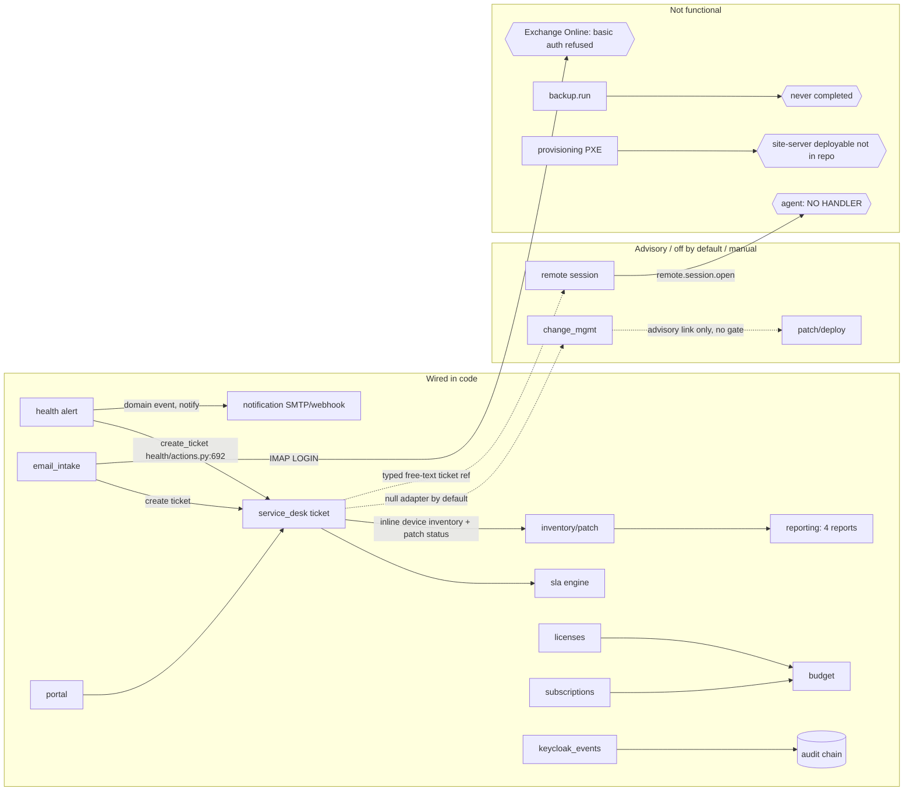

# ITMS: platform coherence, operations and product strategy review

Reviewer 3 of 3 (independent). Lens: how the modules work together as one product, what it costs one person to run it, and where to go next.
Repo state: `main` @ `ca9b002` (2026-09-22). Everything here was read from the tree or measured on 2026-09-23, unless marked **unverified**.

---

## Executive summary

1. **There is far more product than proof.** 29 backend modules, about 264k lines of non-test code (124k Python, 110k TS, 31k Go) plus about 245k lines of tests and 97k lines of Markdown were all written in **about 8 weeks** (first commit 2026-07-30, 629 commits). Yet **no Windows or macOS machine has ever run the agent**: the record table in `docs/modules/agent-distribution/first-run-verification.md:683-720` is empty. For a Microsoft 365 BPO whose fleet is mostly Windows, the platform currently manages none of the machines it exists for.
2. **Three headline capabilities do not work end to end.**
   - **Remote control has no agent side.** `agent/internal/wire/schema_test.go:115` says `"RemoteSessionOpenParams": "remote module: no agent capability planned in this plan"`, yet the console ships a Start Session dialog. `HANDOFF.md:22` ("all 16 job types implemented on both sides") is false.
   - **Backup has never completed a run** (`docs/08-observability.md` §6a), and it ships enabled.
   - **The Windows patch engine has never executed** (`docs/modules/patch/spec.md:225`).
3. **The Microsoft 365 integration is missing, and M365 is Toeshee's actual environment.**
   - Email intake logs in to IMAP with a username and password (`backend/app/modules/email_intake/imap.py:601-607`). Exchange Online has refused Basic auth for IMAP since 2022.
   - The OAuth fix exists only as a **4,474-line plan** (`docs/superpowers/plans/2026-09-11-mail-oauth.md`), with no code: a grep for XOAUTH2 or `login.microsoftonline` in the app finds nothing.
   - There is no Graph integration for users, licences or devices.
4. **People have four unrelated identities. Devices have one, and that part is done well.**
   - A person is `users.id` (Keycloak), a free-text `seat_assignment.assignee_email` (`subscriptions/models.py:65-66`), a free-text `devices.owner` (`models/core.py:384`), and a polymorphic `license_allocation.target_id`.
   - The onboarding chain "new hire → account → licences → device → apps" cannot be built on this.
5. **Integration is real in one direction (alert → ticket → notify) and advisory everywhere else.**
   - Health opens tickets directly (`health/actions.py:692-694`), and a ticket shows device inventory and patch state inline. Those are the product's best seams.
   - Change management is purely advisory (`change_mgmt/links.py:1-9`), and its ticket backend defaults to `null` (`core/config.py:147`, `deploy/.env.example:425`).
   - Starting a remote session asks the operator to *type* a ticket reference (`frontend/src/modules/remote/StartSessionDialog.tsx:45,275`).
6. **The operator burden is high for one person.**
   - 16 compose services and a 3,467-line runbook (`deploy/README.md`).
   - OpenBao must be unsealed by hand with 3 of 5 key shares after every reboot, and until then job signing and the vault are dead.
   - Keycloak realm drift has to be reconciled by hand, one setting at a time.
   - Platform backups are manual, need services stopped, and are not scheduled.
   - OpenBao and Keycloak restore has never been rehearsed (`docs/07-backup-restore.md:17-23`).
   - **Nothing alerts anyone when the platform itself is sick** (`docs/08-observability.md` §6), even though a notification module is sitting right there.
7. **The security invariants are genuinely enforced in code.**
   - Ed25519 signing with no no-op signer, verified on the agent.
   - RLS is FORCEd, and only 5 files use the BYPASSRLS session.
   - The audit log has REVOKE, a trigger and an HMAC chain.
   - AI actions are chosen from a catalogue and always need a human confirm.
   - The cost problem is **consistency**, not laxity. Agent self-update is refused because "the control plane could replace root code while vouching for itself", but `script.run` already runs arbitrary signed bodies as SYSTEM/root (`agent/internal/capabilities/deploy/script.go:11-20`). The refusal buys no risk reduction and costs the fleet its upgrade path.
8. **Engineering hygiene is strong, but the process has become the product.**
   - Measured today: 7,674 backend tests (a security sample of 100 passed), 3,855 frontend tests passed, the Go suite is green, and mypy is clean on 396 files.
   - 35% of Python lines and 41% of Go lines are comments or docstrings.
   - In the last month, 118k Markdown lines were added against 307k code lines.
   - Recent merges to `main` went red or were cancelled (runs #230, #238).
9. **Scope is inverted relative to value.**
   - The largest module is **IPAM**: 11.4k backend + 8.4k frontend lines, with VRFs and VLANs.
   - SLA (6.6k) and Budget (5.2k, with FX rates) are next.
   - Remote control is 2.1k lines and has no agent side. Backup has never run.
   - A 1,733-line MDM spec exists for something that is not built.
10. **Commercial readiness is low, and not because of code quality.**
    - There is one org per identity (`api/deps.py:62-71`, org taken from the token's `org_slug`). There is no MSP org switcher, no LICENSE file, no licence or billing enforcement, and no agent auto-update.
    - MinIO is pinned to a 2025 community image (AGPL, and the community edition is no longer maintained). That conflicts with the vision's "avoid AGPL" posture and is a patching dead end.

---

## 1. Integration map

### Device identity: mostly unified (good)
- There is one `devices` table with `provenance` (`agent`/`operator`/`promoted`/sweep) (`models/core.py:381`). Agentless assets, IPAM observations (`ipam_observation`, `suggested_asset_match`) and agent rows all converge on it.
- `agents` is a 1:1 identity row for enrolled devices.
- This is the right shape, and better than most young RMMs.

### Person identity: fragmented (bad)
| Where a person appears | Representation | Evidence |
|---|---|---|
| Console / portal user, ticket requester | `users.id` (Keycloak `external_subject`) | `models/core.py:53-59`, `service_desk/models.py:130` |
| SaaS seat holder | free-text `assignee_name`/`assignee_email` | `subscriptions/models.py:65-66` |
| Device owner | free-text `owner` String(200) | `models/core.py:384` |
| Licence holder | polymorphic `target_type`/`target_id`, no FK | `licenses/models.py` (`LicenseAllocation`) |
| Email intake sender | parsed address matched to `users` | `email_intake/identity.py` |

Because nothing ties a device to a user, you cannot answer "what does Maria have?" (devices, licences, seats, tickets). An IT team asks that question every day, and the onboarding and offboarding flows depend on it.

### Workflow trace

Flow by flow:

- **Health alert → notification → ticket → SLA.** This chain is real. `health/actions.py` runs remediate, then open_ticket, then notify, with dedup. The SLA engine attaches to tickets. This is the strongest cross-module path.
- **Ticket → change → remote/job → audit.** This chain breaks twice.
  - Change management only records *advisory* links to patch runs and deployments. It never gates them (`change_mgmt/links.py:1-9`).
  - Its ticket backend ships as `null`, so "governance first-class" (`docs/00-vision.md`) is optional and off.
  - A remote session is started from the Remote page, with a typed ticket reference, and then fails at the agent.
- **New employee → provisioning → user_admin → licences → enrolment → apps.** This flow does not exist.
  - "Provisioning" means OS imaging and PXE, and the PXE server "belongs to the deferred site-server deployable" (`docs/modules/provisioning/spec.md:36,585`).
  - `user_admin` manages *console* Keycloak users, not M365 or Entra accounts.
  - Licence and seat assignment use free text.
  - For an M365 shop the modern path is Entra user + licence assignment + Autopilot/Intune, and none of it is here.
- **Inventory → patch → reporting.** This works on Linux (`apt`) and on paper for Windows (a COM WUA engine that has never executed). Reporting has 4 fixed reports (`reporting/definitions/`). `winget` and third-party app patching are not implemented (`docs/modules/patch/spec.md:229`). That is the thing SMB buyers value most after OS patches.
- **email_intake → service_desk.** The code path exists. The transport cannot authenticate to Toeshee's mailbox.

---

## 2. Duplication and merge candidates

| Group | Verdict | Why |
|---|---|---|
| `licenses` + `subscriptions` (+ `budget`) | **Merge the first two into one "Software & SaaS" module; freeze budget** | Both hold vendor, cost, renews_at, seats and an assignment table. `subscription.license_ref` already points across. A two-person IT team keeps one list. Budget (5.2k lines, FX rates) duplicates the ERP (Odoo), which the brief itself says remains authoritative. |
| `ai_admin` + `ai_copilot` + `ai_portal` (+ `core/ai`) | **Collapse to one module with a persona parameter** | 6.5k lines of core plus three thin modules (1.8k / 0.6k / 0.6k) and 3.7k lines of frontend. The personas differ in prompt and tool allowlist, which is data, not a package. |
| `portal` + `ai_portal` | Fold `ai_portal` into `portal` | Same user, same page. |
| `agent_distribution` + `agent_push` + enrolment | **Keep distribution; freeze push** | Push install (3.6k backend + agent `pushinstall` + 1.8k frontend + invariant 2a + a site-server prerequisite) solves a problem M365 shops solve with Intune Win32 apps or GPO, which the runbook already documents (`deploy/README.md` §"A fleet: managed deployment"). |
| `security_logs` / `keycloak_events` / audit | **Keep separate; it is coherent** | `keycloak_events` is a worker adapter into the audit chain (`keycloak_events/__init__.py`), not a duplicate store. `security_logs` is endpoint evidence. The split is correct. |
| `platform-status` / `error-monitor` / `health` | **Join, don't merge** | Endpoint health has notification routing and platform health has none. Route platform probes through the same notification rules. |
| `sla` (6.6k) inside `service_desk` (4.8k) | Keep, but freeze features | The SLA engine is larger than the desk it serves. Calendars and holidays are fine; stop there. |
| `ipam` (11.4k + 8.4k) | **Freeze** | This is a NetBox/phpIPAM-class product inside an RMM for a few hundred endpoints. |

---

## 3. Operator burden (one person, one host)

**Moving parts.** There are 16 compose services: traefik, api, gateway, worker, guacd, migrate, postgres-grants, web, postgres, redis, minio, keycloak, keycloak-init, openbao, openbao-init, plus the gateway TLS and CA volumes. 12 are long-running. There are two Postgres clusters in effect (app plus Keycloak) and three stateful secrets stores (Postgres, OpenBao, `.env`).

**Runbook weight.**
- `deploy/README.md` is **3,467 lines**; `GO-LIVE.md` is 495; `.env.example` is 594 lines for 48 keys.
- First boot is 11 manual steps.
- "Sign in with Microsoft" is manual ("by hand, for now", `deploy/README.md:1290`).
- `deploy/scripts/deploy.sh` is a genuinely good idea: it diffs the running tag against HEAD and runs only the steps that matter. It is well defended against the 2026-08-27 image-drift incident.

**What breaks at 3am.**

| Event | Result | Recovery | Evidence |
|---|---|---|---|
| Host reboot or power blip | Docker restarts containers (`restart: unless-stopped`) and OpenBao comes up **sealed**. Job signing (OpenBao transit), the CA and credential decryption all fail. The console loads but cannot act. | A human with 3 of 5 key shares stored *off-host* | `GO-LIVE.md:284-298` |
| Worker wedged | A heartbeat file exists, but "this is an OBSERVABLE SIGNAL … not a self-healing mechanism", and nobody is alerted | Operator notices, eventually | `docker-compose.yml` ~L240, `docs/08-observability.md` §6 "No alerting" |
| Disk fills (MinIO holds endpoint backups on the same host) | Everything stops | Manual | Single host |
| Host lost | The control plane **and the endpoint backups** go together, because MinIO is local | Restore-from-backup, whose OpenBao and Keycloak half has never been executed | `docs/07-backup-restore.md:17-23` |
| Keycloak config change shipped in the repo | Never reaches the running host (`--import-realm` skips an existing realm); the account console may still be open on the live host | Manual `kcadm.sh` per setting | `deploy/README.md:956-1016` |

**Specific fixes.**
- **Auto-unseal.** Use OpenBao's static-key or transit auto-unseal, sealed with a key file on a separate mount or with a TPM. That trades a slightly weaker at-rest story for a platform that comes back after a power cut. For a one-person team, the availability loss from manual unseal is a bigger real risk than the at-rest threat it guards against. At minimum, make it a documented, supported option.
- **Declarative realm reconciliation.** Use keycloak-config-cli (Apache-2.0) in `keycloak-init`, with an explicit allowlist of settings owned by the repo.
- **A scheduled, verified platform backup.** A systemd timer that runs `backup.sh` plus `mc mirror` to a *different* host, and a monthly scripted restore into a throwaway stack.
- **Wire platform health into `notification`.** It is roughly a day of work and gives the platform's own outages a pager.

---

## 4. Security posture reality check

**Enforced, with evidence.**
- **Signing.** `backend/app/core/signing.py:1-7` ("deliberately no 'noop' signer"). Production uses OpenBao transit, and production refuses to auto-generate a key (`MissingSigningKeyError`). The agent verifies Ed25519 before running anything (`agent/internal/jobs/verify.go`, `runner.go:182`), and `verified.go` makes an unverified job unrepresentable.
- **Tenancy.** Every request resolves the org, then opens `org_session` (`api/deps.py:62-73`). BYPASSRLS `admin_session` appears in only 5 files (`ai_admin/api.py`, `keycloak_events/sweep.py`, `budget/fx.py`, `api/v1/setup.py`, `core/tenancy.py`). I ran `test_rls.py`, `test_rls_invariant_sql.py` and `test_tenant_column_sweep.py`: all pass.
- **Audit.** `REVOKE UPDATE, DELETE ON audit_events FROM app_user` (`deploy/postgres/grant-app-privileges.sql:58`, migration `0009`), a BEFORE UPDATE/DELETE trigger (`0004_audit_hardening.py:29`), and an HMAC-keyed chain that fails closed in production (`core/audit.py:45-59`).
- **Vault.** The remote credential is never persisted, only held in memory (`remote/service.py` docstring). Presigned object URLs are scope-restricted and were measured against real MinIO behind Traefik.
- **AI.** The model can only pick an `approved_action` key; parameters come from an admin-authored row. The confirm needs a human and the permission of the target module. The autonomy dial is capped below `autonomous` by a DB CHECK (`core/ai/act.py:1-30`, `docs/06-roadmap.md` Phase 18). This is a well-built safety design.

**Cost without matching risk reduction.**
1. **Self-update refused on grounds already conceded elsewhere.**
   - `agent/packaging/README.md:535-552` says self-update would let a compromised control plane "replace root/SYSTEM code on every endpoint while vouching for itself".
   - But `script.run` and `app.deploy` already let a signing control plane run arbitrary code as SYSTEM or root (`deploy/script.go:11-20`).
   - An `agent.update` signed job pinning a release SHA-256 is **no new power**, and cert renewal already uses exactly this pattern.
   - The refusal leaves a mixed-version fleet with no upgrade path except GPO or Intune re-push, which is the thing CLAUDE.md calls an outage risk.
2. **Invariant 2a / push install.** It is a genuinely careful design (the "vouched-for" allowlist is good thinking). But it is a big governance and code surface for a problem Toeshee's M365 and Intune estate already solves.
3. **85 permission codes** (`docs/product.md` §4) for a team of one to three. Fine to keep in code, but ship three roles and hide the matrix.
4. **Five-share OpenBao unseal on one host** (see §3). With the shares off-host, a reboot is a manual incident.

**Real gaps.**
- **The control plane is the crown jewel, and signing does not protect against its compromise.** The API's OpenBao token can sign (transit), so anyone who owns `api` owns the fleet. That is inherent and is stated in `03-security-model.md`. It means host hardening, MFA on Keycloak and the admin path matter more than more invariants. Passkeys and TOTP exist; the account console on the live host may still be open (realm drift).
- **The MinIO secret is fleet-wide.** A leaked `ITS_S3_SECRET_KEY` allows listing through the route (`HANDOFF.md` §2). Acknowledged, not mitigated.
- **The Windows agent's trust on the endpoint is unproven.** There is no Authenticode signature (`docs/modules/agent-distribution/authenticode-signing.md`), the SCM/ACL behaviour has never been observed, and Defender/ASR interaction is unknown. The first real Windows install could meet SmartScreen or ASR blocks.
- **Supply chain.** `minio/minio:RELEASE.2025-09-07` is pinned to a community image that no longer receives upstream binaries (**unverified from this sandbox**; based on MinIO's 2025 community-edition changes). `redis:7-alpine` floats and is licensed RSAL/SSPL from 7.4, AGPL in 8.

---

## 5. Engineering health (numbers)

| Metric | Value | How measured |
|---|---|---|
| Backend app code | 123,749 lines Python (396 files) | `find backend/app -name '*.py'` |
| Backend tests | 426 files, 203,377 lines, **7,674 tests collected** | `pytest --collect-only` |
| Backend comment/docstring share | **35%** (11.3k comment + 32.3k docstring lines) | tokenize pass over `backend/app` |
| Go agent | 30,890 non-test lines, 41,470 test lines; 12,701 `//` comment lines (**41%**) | `find agent` |
| Frontend | 109,882 non-test TS/TSX lines, 146 test files, **3,855 tests** | `vitest run`: all passed (170s) |
| Docs | 154 Markdown files, **97,282 lines**; CLAUDE.md 376 lines; 24 design specs + 36 plans under `docs/superpowers` | `wc -l` |
| Migrations / tables | 83 migration files / 136 `__tablename__` | grep |
| Type checking | `mypy app`: **Success, 0 issues in 396 files**; 5 `any` hits in frontend source | ran |
| Agent CI | Yes: gofmt, vet, staticcheck, `go test`, budget tests, 6-target cross-compile, .deb install/purge, shellcheck, systemd verify (`.github/workflows/ci.yml:571-826`). **Linux runner only**; Windows code is compile-checked, never executed | read |
| My runs | Go `go test ./...`: all packages ok. Backend security sample (roadmap, rbac, signing, audit, rls, tenant sweep, health): **100 passed** | ran |
| CI on `main` | Runs #230 and #238 **failed**, #234 and #236 **cancelled**, #242 success, #245 queued | GitHub Actions API |
| Commit mix, last 30 days | 303 commits; +118k Markdown lines vs +307k code and +322k test lines | `git log --numstat` |

**Per-module size (backend / frontend lines):** ipam 11.4k/8.4k, health 10.8k/5.4k, sla 6.6k/3.8k, budget 5.2k/4.3k, service_desk 4.8k/4.4k, email_intake 4.7k/1.6k, notification 3.6k/2.7k, agent_push 3.6k/1.8k, patch 3.5k/6.4k, reporting 3.4k/1.9k, backup 3.2k/2.5k, deploy 2.5k/2.7k, remote **2.1k/1.8k**, inventory **1.4k/1.3k**.
The two modules that matter most to a helpdesk (remote, inventory) are among the smallest. The ones that matter least to a 300-seat company (IPAM, SLA, budget) are among the largest.

**Honesty of "verified" claims.** This is mixed, and better than most projects: the specs are unusually candid about what has never run. The problems are in the summary documents.
- `docs/product.md` §4 says the idle budget is "measured by a benchmark in CI, not asserted". What CI actually asserts is **proxies**: zero allocations, a constant goroutine count, no writes on a quiet tick, and flat RSS *delta* (`agent/internal/budget/budget.go:19-67`). It never measures the absolute "low-tens-of-MB" RSS of the real binary idling, never CPU%, and never on Windows or macOS. `budget.go` says this honestly; `product.md` flattens it into "measured".
- `HANDOFF.md:22` claims "all 16 job types implemented on both sides", which contradicts `agent/internal/wire/schema_test.go:115` (remote) and the agent's actual handlers.
- `docs/product.md` §3 lists "Audited remote control" and "Backup and restore" under "What it does today". Neither completes end to end.
- The "measured on date X" and "pinned by a test" culture is excellent. But it pins *counts* (log call sites, route counts, RLS policy counts). It does not pin *outcomes* such as "a Windows machine ran a signed job".

**Process overhead.** The discipline (spec → plan → TDD → verify, falsifiers, dated corrections) produced real rigour: the budget-test `-bench` trap, the `pipefail` note, and the presigned-URL routing work are all excellent catches. But the same ritual is applied to an email test-send fix and to a 4,474-line plan for OAuth that has not shipped. Every comment block re-litigates history ("this was wrong on date X because…"), which makes the code slow to read and edit. The team is writing about 0.4 lines of prose per line of product code, and the modules that need a *Windows VM for an afternoon* have not had one.

---

## 6. AI features

- **Safety: good.** The propose → preview → confirm model, catalogue-key-only actions, a persisted preview with a digest, the least reach for the persona exposed to email ingress, and the autonomy ceiling enforced in the DB. Invariant 1's "no AI actor reaches destructive actions" is respected by construction.
- **Value right now: low.**
  - A copilot over a fleet where remote, backup and Windows patch don't work is a chat window over empty tables.
  - The end-user resolver depends on email intake, which cannot reach M365.
  - For one operator, the useful AI features are narrow: ticket triage and summarisation, "explain this alert", and drafting a script for human review.
  - Three modules (plus 6.5k core lines, a 2,102-line automation spec and a 2,016-line ai-admin spec) is a lot of carrying cost.
- **Recommendation:** freeze. Keep the substrate, merge the three into one module, and put effort back into the fleet paths the AI would act on.

---

## 7. Commercial readiness

| Need of a paying MSP or IT department | State |
|---|---|
| Windows agent that installs cleanly, is signed, and auto-updates | Unsigned, never run on Windows, no self-update |
| Remote control (the number one RMM feature) | Server side only; no agent capability; the RDP design would log off the interactive user on Windows clients (shadowing is "v2 WebRTC") |
| Third-party patching (Chrome, Adobe, Zoom, via winget or a catalogue) | Not implemented |
| Backup that has restored something | Never completed a run |
| MSP multi-tenant console (switch clients, cross-client dashboards, per-client branding) | One org per identity via the token's `org_slug` (`api/deps.py:62-71`); RLS is ready, the product is not |
| Install in under an hour | 11-step first boot, 3,467-line runbook, manual unseal |
| Licensing / entitlement / billing | None; no LICENSE file in the repo; the open-core split exists only in `00-vision.md` |
| M365 / Entra integration | None |
| Dependency licence hygiene for open core | MinIO (AGPL, community edition unmaintained) and Redis 7.4+ (RSAL/SSPL) conflict with the stated posture |

**Competitive position.**
- **Against Action1** (free for up to 200 endpoints, strong Windows and third-party patching), **NinjaOne/Datto** (mature remote, patch and scripting) and **Intune** (already paid for in most M365 SKUs), ITMS today has nothing to win on in endpoint management.
- **Against Freshservice or Jira SM**, the service desk is competent but not differentiated.
- **The defensible niche is real:** self-hosted, audit-grade governance, where the tool that performs the change produces the SOC 2 evidence (patch compliance + change record + audit chain + DR test). But it only becomes defensible once the endpoint layer works, and change management is currently advisory and off by default.
- **Realistic positioning** is a *governance and evidence layer that sits beside Intune*, not a replacement for NinjaOne.

---

## 8. Strategy

### Double down
1. **Windows endpoint reality.** Enrol real Windows 10/11 machines, finish the first-run record, sign with Authenticode, and add a Windows CI runner that actually *executes* the agent's tests and a signed `hello`/inventory/patch.scan round trip.
2. **The helpdesk loop Toeshee lives in:** M365 mail intake (the OAuth code), ticket ↔ device ↔ user, remote assistance, and alert → ticket.
3. **Patch compliance and evidence reporting**, the thing SOC 2 wants. Make change → patch linking a real gate (optional per policy) and turn the ticket backend on by default.
4. **Agent self-update as a signed job.** It unblocks everything else.
5. **Operability:** auto-unseal, scheduled off-host backups with a restore drill, platform alerts through `notification`, and declarative Keycloak config.

### Freeze (keep running, no new features)
IPAM, SLA, budget, BCP, documentation, reporting (beyond patch and backup evidence), the three AI modules, agent push install, provisioning/PXE (the site-server deployable is not even in the repo), keycloak theming.

### Cut or defer explicitly
- **MDM** (spec only; Intune already does this for an M365 shop; remove it from 00-vision's reversed scope).
- **Budget / FX** (the ERP owns it).
- **Push install** beyond what exists (GPO/Intune is the answer).
- **The prose tax.** Cap spec and plan length, stop dated-correction narratives in code comments, and move history to commit messages.

### Remote control, a specific call
Do not build an RDP-via-guacd attended helpdesk path: it disconnects the Windows user. Two options:
- **(a)** Integrate a licensed third-party remote tool (for example a self-hosted MeshCentral, Apache-2.0, launched via a signed job and a deep link from the ticket).
- **(b)** Build the WebRTC screen-share capability in the agent.

(a) is weeks and (b) is months. Choose (a) for Toeshee now.

---

## 9. A 90-day plan for Toeshee's own IT team

**Days 0–30: make it manage the real fleet.**
- Run `first-run-verification.md` parts A and B on two Windows VMs, and fill in the record table.
- Fix what breaks.
- Buy an Authenticode certificate (OV is enough to start) and sign in CI.
- Build `agent.update` as a signed job pinning a SHA-256, with the service manager handling rollback. Test it on those VMs.
- Add a Windows GitHub runner job: `go test` for `service`, `health` and `patch` on real Windows.
- Ship mail OAuth cycle B (IMAP XOAUTH2 + SMTP XOAUTH2) and nothing else in that plan.
- Enable OpenBao auto-unseal. Put `backup.sh` + `mc mirror` on a systemd timer to a second box.
- Wire platform-status probe failures to the notification module (email the operator).

**Days 31–60: close the helpdesk loop.**
- Roll the agent to the whole fleet through Intune (Win32 app) or GPO, in rings of 10 → 50 → all.
- Add `devices.primary_user_id` (FK `users`), populated from the inventory's last-logged-on user. Link tickets, licences and seats to it. Add a Graph read-only sync of users and M365 licence SKUs into subscriptions.
- Add a remote-assistance deep link from the ticket via MeshCentral or an existing tool, and remove the free-text ticket reference.
- Turn on the `service_desk` change backend by default.
- Get a first successful `backup.run` **and restore** on one Windows file-server path, or formally scope backup to "not in v1" and remove it from the console.

**Days 61–90: evidence and hardening.**
- Add winget-based third-party patching for the top 20 apps.
- Produce a patch-compliance + change-record + audit-chain export for one month of real data (the SOC 2 artefact).
- Rehearse a full restore (Postgres + OpenBao + Keycloak + MinIO) onto a spare host, timed.
- Reconcile the Keycloak realm with keycloak-config-cli.
- Replace MinIO with a maintained S3 store (for example Garage, SeaweedFS, or a pinned-and-patched fork) and Redis with Valkey.
- Measure the real agent's idle RSS and CPU on Windows over 24 hours and publish the number.

**Exit test:** 100% of Toeshee Windows endpoints enrolled; one ticket that came in by M365 email, showed the user's device, got a remote session and a patch, and is traceable in the audit chain; one restore performed from backup.

---

## 10. Ranked top 15 improvements

| # | Improvement | Impact | Effort |
|---|---|---|---|
| 1 | Run and record Windows first-run verification; fix what breaks; enrol the real fleet | Critical: turns the platform from theory into a tool | M |
| 2 | Agent self-update as a signed job (SHA-256 pinned, service-manager rollback) | Critical: every future agent fix depends on it | M |
| 3 | Authenticode-sign the Windows agent in CI | High: SmartScreen/ASR/Defender acceptance, and a prerequisite for WDAC | S (plus procurement) |
| 4 | Ship IMAP/SMTP XOAUTH2 for Exchange Online (mail OAuth cycle B only) | High: email intake and notifications work in M365 | M |
| 5 | Remote assistance that actually connects (third-party tool via signed launch + ticket deep link); hide the current Start Session until then | High: the number one helpdesk feature | M |
| 6 | OpenBao auto-unseal option + platform health → notification alerts | High: the 3am outage becomes self-recovering and visible | S |
| 7 | Scheduled off-host platform backup + a rehearsed full restore (incl. OpenBao/Keycloak) | High: current DR is unproven | S–M |
| 8 | One person identity: `devices.primary_user_id`; seats and licence allocations reference `users`; Graph user + SKU sync | High: unlocks onboarding/offboarding and "what does X have" | M |
| 9 | Windows CI runner that *executes* agent tests (service, patch COM, health posture) | High: stops unverifiable Windows code accumulating | S |
| 10 | winget third-party patching | High: the most visible patching value for SMB | M |
| 11 | Change ↔ ticket backend on by default; optional "require approved change" policy on patch/deploy | Medium: makes the governance claim true | S |
| 12 | Declarative Keycloak config (keycloak-config-cli) to end realm drift | Medium: security (open account console) plus ops | S |
| 13 | Correct the summary docs (`product.md` §3–4, `HANDOFF.md`) to "built / measured / works end-to-end" per module; delete claims that aren't true | Medium: trust, and stops the next session building on false premises | S |
| 14 | Freeze IPAM/SLA/budget/BCP/AI/push/MDM; merge licences + subscriptions and the three AI modules | Medium: less carrying cost, smaller surface to secure | M |
| 15 | Replace MinIO (AGPL, unmaintained community edition) and float-pinned Redis 7 with maintained, permissively licensed equivalents | Medium: patchability and open-core licence posture | M |

---

### Not verified in this review
- Whether the live host at `itms.toeshee.com` has any enrolled endpoints, or what OS they run.
- The full backend suite (about 25 min). I ran a 100-test security sample only.
- The exact current state of the MinIO community image and Redis licensing: based on upstream 2025 announcements, not checked from this sandbox.
- Whether PR-level CI was green before the red merges to `main`.
- The runtime behaviour of the RDP-via-guacd path (my claim that it disconnects the console user is standard Windows client RDP behaviour, not observed here).
